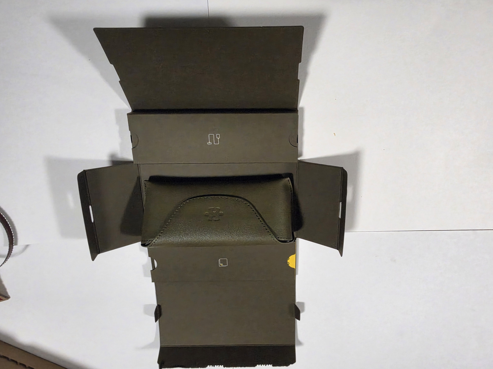
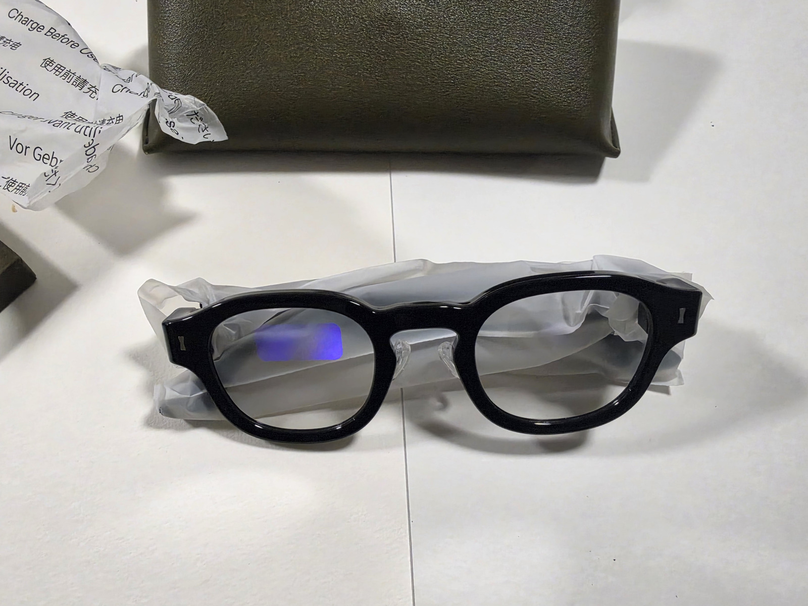
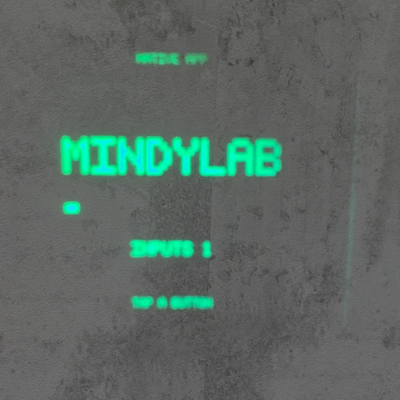
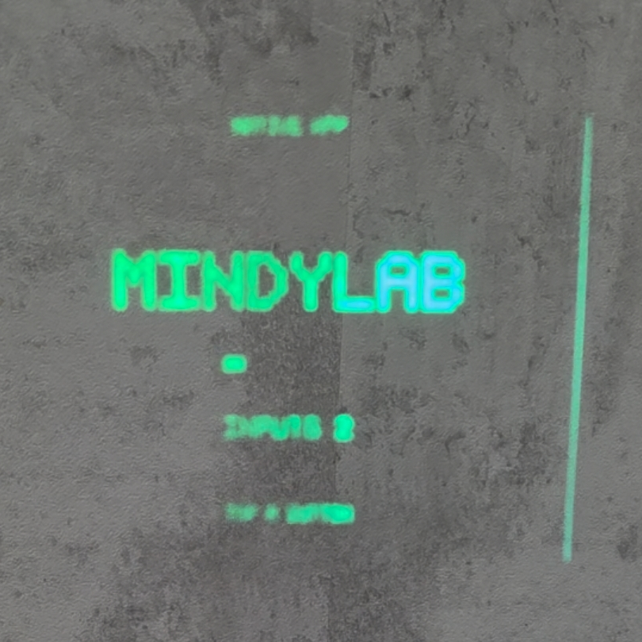

# Halliday G2 — from a closed companion to our own apps

An independent owner-led research project: firmware preservation, a custom Android companion, and native apps for **Halliday G2** glasses. This is **not Even Realities G2**, and it is not the original Halliday/DigiWindow hardware.

We bought G2 for its potential, then ran into the limits of the available apps and customization. That disappointment became a research project. Our downloader captured an official update; firmware analysis led to authenticated Wi-Fi/FTP access; backups and a modified four-contact charging cable led to working USB/ADB. We then built MINDYLAB, a native screen with working tap input. It now starts from our phone app without a USB cable, after a small, tested startup modification to the original firmware.

Read the [short project story](docs/STORY.md) for the journey, including the failures and the limits of what we have proved.

> **Use at your own risk — no warranties or guarantees.** These are experimental tools and research materials. You take full responsibility for using or modifying them, including any device damage, bricking, data loss or service disruption. We do not promise safety, compatibility, successful flashing or recovery. See the [full disclaimer](DISCLAIMER.md), subject to applicable law.

## From unboxing to our own native app

| Opening the G2 package | The glasses after unboxing |
|---|---|
|  |  |

**MINDYLAB on the actual G2 display:** two frames from the owner's recorded demo show the input counter changing from **1** to **2**. This is our native screen, not text inserted into the stock dashboard note card.

| MINDYLAB — input count 1 | MINDYLAB — input count 2 |
|---|---|
|  |  |

These are genuine owner-supplied photos and video-frame screenshots, cropped locally with no AI retouching. Phone UI and unrelated thumbnails were removed; identifying metadata was stripped before publication. The originals remain private. [Image processing and privacy details](docs/images/README.md).

## What works — and what does not

| Capability | Evidence as of 25 October 2026 |
|---|---|
| Save official G2 firmware offered to an account | Working downloader; captured OTA 1.1.1 included |
| Authenticate Bluetooth and send dashboard text | Confirmed on the glasses |
| Read filesystem/firmware over Wi-Fi/FTP | Confirmed; private backups retained locally |
| Enable the four-contact port for USB/ADB | Confirmed on our unit after cable and configuration changes |
| Run our native MINDYLAB screen and count taps | Confirmed on installed 1.0.1/build 2018 |
| Keep the extra app across restart; Start/Stop from phone without G2 USB | Confirmed, including corrected tap isolation and dashboard return |
| Native Maps/Waze navigation | Experimental source included; limited Start/Stop hardware evidence, not a fully validated navigation product |
| Build and flash a complete replacement firmware | **Not achieved** |
| Restore a dead/unbootable G2 independently of stock firmware | **Not proved** |

The permanent-app experiment changed one startup sector of stock firmware. It was **not** a full source rebuild, complete original-firmware reinstall, or independent unbrick test. Native addresses in this repository target **1.0.1.202609052141, build 2018**; the captured **1.1.1 OTA is a different image**.

## Included

- [Firmware Preserver](halliday_fetcher/): Python desktop downloader and synthetic tests.
- [G2 Display Lab](g2_companion/): Android companion, BLE protocol, read-only backups, native-app controls and experimental navigation relay. [Build/use guide](docs/ANDROID.md).
- [Native apps](native/): exact source and ARM ELF objects for proven MINDYLAB and an experimental navigation candidate. [Native-app guide](docs/NATIVE-APPS.md).
- [RAM marker](g2_native_probe/): minimal module that changes its own RAM and returns.
- [Firmware](firmware/): unmodified official 1.1.1 component OTA, manifest and offline verification. **No private 1.0.1 device dump.**
- [Technical findings](docs/RESEARCH.md), [privacy boundaries](docs/PRIVACY.md), and [release validation](docs/VALIDATION.md).

## Start with the downloader

On Windows with Python 3.11+:

```powershell
py -3 -m venv .venv
.\.venv\Scripts\python.exe -m pip install -r requirements.txt
.\start.cmd
```

Open **G2 firmware downloader**, sign in locally with your own account, select your already-bound glasses, then choose **Check and save now**. [Detailed instructions and server-side effects](docs/DOWNLOADER.md).

For Android, use the [public research APK](releases/G2-Display-Lab-0.18-public.apk) or build from source. The public build deliberately disables the original owner-specific USB flag write workflow. Installing the phone APK alone does **not** install a native app inside the glasses.

## Direction of the project

The goal is a useful, private platform: our own apps, navigation, local meeting transcription models and voice controls. These are goals, not a claim that all are implemented. The present account sign-in still contacts Halliday, and stock services retain their own behavior. Full privacy and complete replacement firmware require more work.

This repository contains a curated public snapshot. Only the explicitly approved, sanitized photos above are shared; account data, binding keys, device identifiers, original personal media, raw research logs and device-specific backups are excluded. Vendor firmware remains vendor material; see [rights and provenance](NOTICE.md). No affiliation with or endorsement by Halliday is claimed.
