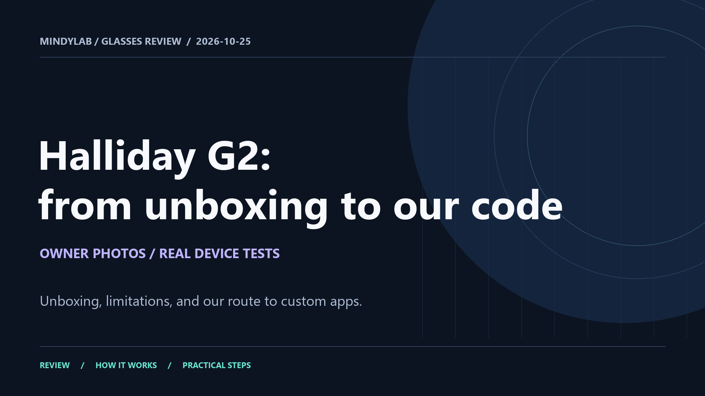

# Halliday G2: English unboxing and review

[](Halliday-G2-English-Review.mp4)

**[Open video](Halliday-G2-English-Review.mp4)** · **[Download MP4](https://github.com/COREkunas/G2Glasses/raw/refs/heads/main/docs/video/Halliday-G2-English-Review.mp4)** · [English subtitles](Subtitles_EN.srt)

**4:50 · 1920 × 1080 · 30 fps · 17.9 MiB.** A photo-based review with English synthetic narration, burned-in subtitles and intro/outro music. The two MINDYLAB views are real owner screenshots, not continuous demo footage. Research snapshot: 25 October 2026; published 28 October 2026.

The story follows unboxing and software limitations, the firmware downloader, authenticated Wi-Fi/FTP access, verified backups, a modified four-contact cable, USB activation and a working native app controlled from the phone. It separates our demonstrated native app and small stock startup patch from full custom firmware and independent recovery, which are still research goals.

The preview opens the MP4 file on GitHub. Use the direct download link to save and play it locally. [Public media hashes and checks](media-audit.json) · [Project story](../STORY.md) · [Privacy boundaries](../PRIVACY.md).

## Chapters

```text
00:00 Introduction
00:04 Glasses with untapped potential
00:16 Opening the box
00:29 Familiar shape. Unusual possibilities.
00:45 Different optics, less discretion
01:14 We wanted more than a preset menu
01:31 Updates do not make an open platform
01:45 The first clue: a firmware copy
02:00 Bluetooth → Wi-Fi → FTP
02:13 Backups before changes
02:29 Four contacts. Two obstacles.
02:45 USB finally responded
03:00 MINDYLAB: our code inside the glasses
03:15 Launch from the phone. No USB.
03:29 What works, and what comes next?
03:46 Next: our own firmware
04:02 A start, with more work ahead
04:20 Project results on GitHub
```

## Disclaimer

These tools are experimental and supplied as is. Users take responsibility for using them; no safety, compatibility, successful flashing or recovery is guaranteed. Device damage and data loss are possible. The full [project disclaimer](../../DISCLAIMER.md), subject to applicable law, applies. See [rights and provenance](../../NOTICE.md).

Project: https://github.com/COREkunas/G2Glasses
